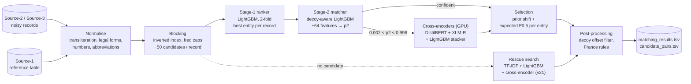
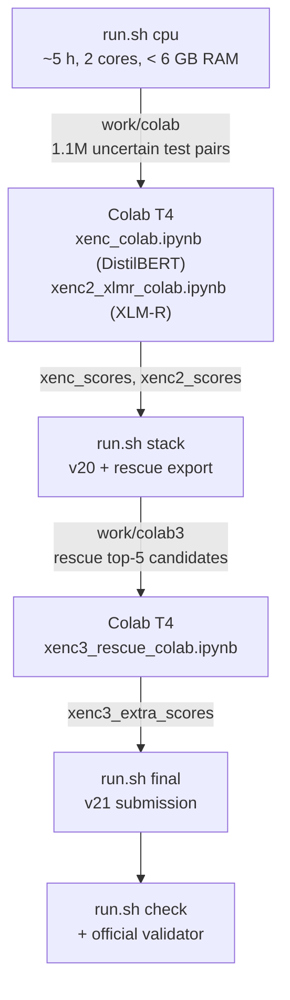
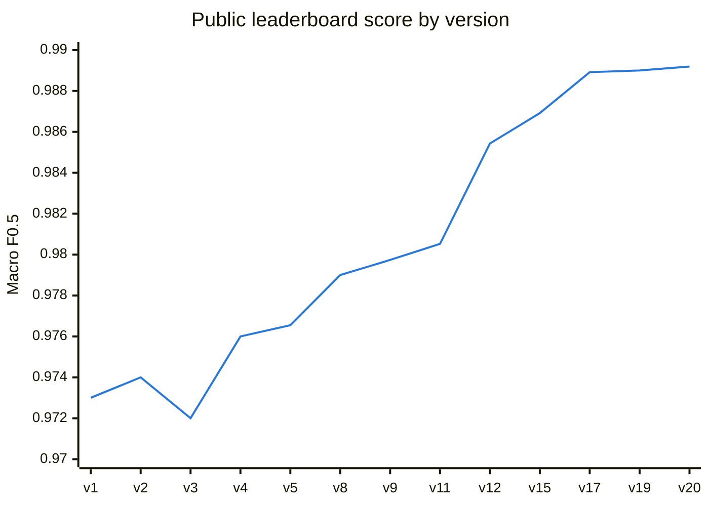
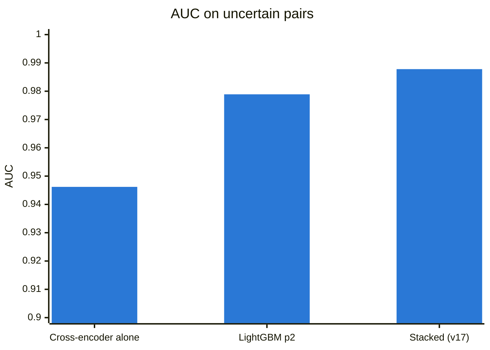
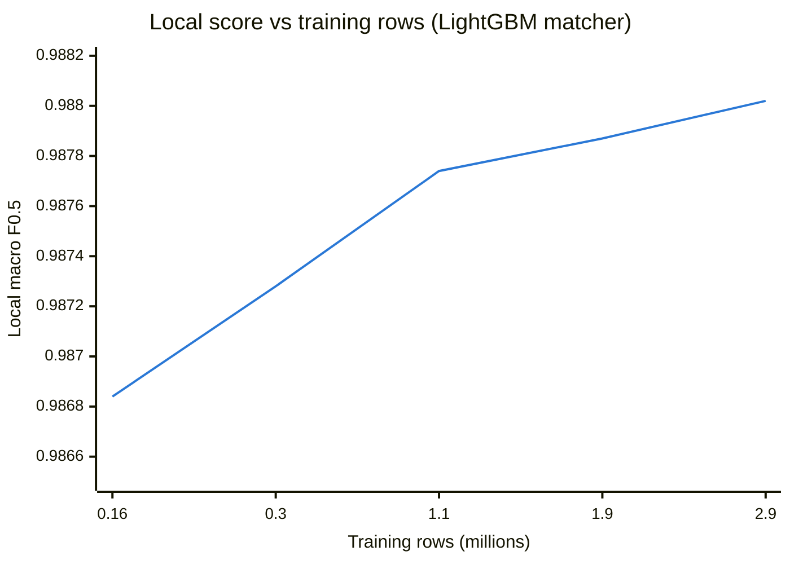
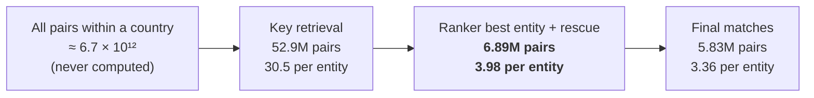
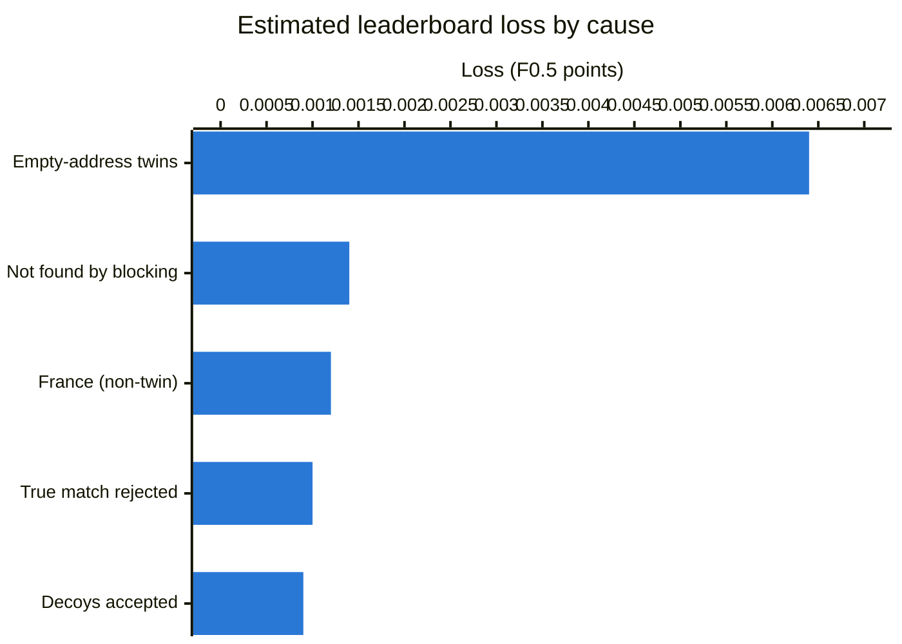

# Business Entity Resolution: Amazon ML Challenge 2026 (team Ekdant.exe)

This project matches noisy business records (Source-2 and Source-3) to a reference table (Source-1) in the US, India and France. The test set also contains deliberate **decoys**: near-copies of a business that belong to nobody.

- **Final submission: v21.** The metric is macro F0.5 per Source-1 entity.
- **Best public leaderboard score:** 0.989191 (v20). v21 adds +0.0002 locally on top of it.
- **Full write-up:** [`REPORT.md`](REPORT.md) covers the problem, every challenge we hit and how we solved it, the results and future work.

## Architecture


### CPU / GPU workflow
The work machine had no GPU, so the transformer steps run in free Colab notebooks between the CPU steps of `run.sh`.


## Benchmarks

### Public leaderboard by version
Macro F0.5 per Source-1 entity. Only uploaded versions are shown; v21 was the final, private-leaderboard submission.



| version | key change | public LB | gain vs previous row |
|---|---|---|---|
| v1 | blocking + LightGBM ranker + matcher, one global threshold | 0.973000 | |
| v3 | lower threshold (more matches) | 0.972000 | −0.0010 |
| v5 | decoy house-number post-filter | 0.976549 | +0.0045 |
| v9 | decoy-aware stage-2 matcher | 0.979740 | +0.0032 |
| v11 | decoy-word scores, prior shift, expected-F0.5 selection | 0.980524 | +0.0008 |
| v12 | France rules from the label-free count profile | 0.985429 | **+0.0049** |
| v15 | positional house-number features, 3.9× training rows | 0.986916 | +0.0015 |
| v17 | + DistilBERT cross-encoder on uncertain pairs | 0.988917 | **+0.0020** |
| v19 | + XLM-R cross-encoder | 0.989000 | +0.0001 |
| v20 | LightGBM stacker, prior shift ×1.75 | **0.989191** | +0.0002 |
| v21 | cross-encoder re-scoring of rescue candidates | final | local +0.0002 |

### Local harness vs leaderboard
The local US+India harness (`evaluation/evaluate.py`) weights decoys to the test density. Since v15 it has predicted each leaderboard gain within about 0.0004.

| version | local US+India | local gain | LB gain |
|---|---|---|---|
| v10 | 0.98690 | | |
| v15 | 0.98787 | +0.00097 | +0.0015 (vs v12) |
| v16 | 0.98816 | +0.00029 | not uploaded |
| v17 | 0.98955 | +0.00139 | +0.0020 (vs v15) |
| v19 | 0.98969 | +0.00014 | +0.00008 |
| v20 | 0.98981 | +0.00012 | +0.00019 |
| v20 → v21 (with rescue) | 0.99046 → 0.99067 | +0.00021 | final |

### Cross-encoders on the uncertain band
AUC on the 56K labelled uncertain pairs (0.002 < p2 < 0.998). The cross-encoder is weaker alone, but its errors differ from LightGBM's, so the stack beats both.



| metric | before | after |
|---|---|---|
| band AUC (p2 → stacked) | 0.9789 | 0.9878 |
| false positives, US | 325 | 190 |
| false positives, India | 325 | 171 |
| rescue AUC (v21) | 0.9788 | 0.9933 |
| rescue top-1 correct (of 19,305) | 16,194 | 17,134 |

### More data, smaller gains
Learning curve of the LightGBM matcher. Each doubling of training rows now adds about +0.0001, which is why we moved to cross-encoders.



### Candidate funnel
Blocking never compares all pairs: each record looks up its own keys in an inverted index, so the cost is linear in the number of records.


On labelled held-out data, the candidate set keeps **97.7%** of true pairs (3.62 candidates vs 3.47 true matches per entity).

### Where the remaining loss is (v20, estimated)
Total loss is 1 − 0.989191 ≈ 0.0108. About 60% comes from empty-address records whose name belongs to 2+ entities; no signal in the data separates those.



### Runtime and resources
| step | hardware | time |
|---|---|---|
| `run.sh cpu` | 2 CPU cores, < 6 GB RAM | about 5 h |
| each cross-encoder notebook | free Colab T4 | 35–70 min |
| `run.sh stack` / `final` | 2 CPU cores | minutes |

## Folder layout
```
README.md                  this file: layout and how to run
REPORT.md                  complete project report
run.sh                     the single pipeline script (steps: stage1 | cpu | stack | final | check)
requirements.txt           CPU packages (Python 3.11)
src/                       pipeline code (table below)
models/                    trained models behind the submitted file
evaluation/                local mini-leaderboard + label-free test checks + format check (see evaluation/README.md)
  deep/                    loss breakdown, miss kinds, twin rates, offset cells, leak checks
gpu_crossencoder/          Colab notebooks for the 3 cross-encoder runs + requirements-gpu.txt
docs/
  APPROACHES_AND_LESSONS.md  detailed log: every version, lesson and dropped idea
  DEEP_ANALYSIS.md           detailed error analysis and future-work list
```

## Run (final v21)
```bash
pip install -r requirements.txt
DS=/path/to/student_resource/dataset

# (optional, first time) retrain the stage-1 ranker; models/ already holds trained copies
# bash run.sh stage1 $DS work out_v1   # then copy work/model_stage1_* and work/model_stage2_cf.* into models/

# 1. CPU: data -> blocking -> features -> matchers -> export of the uncertain pairs   (about 5 h on 2 cores, < 6 GB RAM)
bash run.sh cpu $DS work output
# 2. GPU (free Colab T4): gpu_crossencoder/xenc_colab.ipynb and xenc2_xlmr_colab.ipynb on work/colab
#    -> xenc_scores.csv.gz, xenc2_scores.csv.gz
# 3. stack the cross-encoders (v20, also written to output/ as a fallback) and export the rescue candidates
bash run.sh stack $DS work output xenc_scores.csv.gz xenc2_scores.csv.gz
# 4. GPU: gpu_crossencoder/xenc3_rescue_colab.ipynb (xtrain parts from work/colab + work/colab3) -> xenc3_extra_scores.csv.gz
# 5. final v21 and the format check
bash run.sh final $DS work output xenc3_extra_scores.csv.gz
bash run.sh check $DS work output
python3 /path/to/student_resource/utils/validate_submission.py \
    --matching output/matching_results.tsv --candidate output/candidate_pairs.tsv --test-dir $DS/test
```
Each GPU run takes about 35–70 minutes on a T4.

## Code map (`src/`)
| step | scripts | what it does |
|---|---|---|
| data | `convert.py` | TSV → parquet |
| normalise | `prep.py`, `normalize.py`, `learn_translit.py` | Indic transliteration (`resources/indic_token_dict.json`), accents, leet-speak, legal forms, street abbreviations, states, numbers, PIN |
| blocking | `run_blocking.py`, `keys.py`, `blocking.py` | composite-key inverted index, per-kind frequency caps, top 50 by summed IDF |
| features | `build_features.py`, `features.py`, `select_T.py`, `select_T2.py`, `prep_T2.py` | about 64 pairwise features; held-out subsets V, T and training subsets T2–T4 |
| stage 1 | `crossfit.py`, `train.py`, `metrics.py`, `make_submission.py` | 2-fold LightGBM ranker (best entity per record) |
| stage 2 | `stage2.py`, `stage2_v2.py`, `decoy_features.py`, `stage2_v14.py`, `extra_feats.py`, `extra_test.py` | decoy-aware matcher, prior shift, expected-F0.5 selection, upward-offset cap |
| post-processing | `decoy_postfilter.py`, `france_fix.py`, `france_fix2.py`, `merge_countries.py` | offset-cell decoy filter, France rules, US/India + France merge |
| rescue | `rescue_queries.py`, `rescue_cands.py`, `rescue_score.py`, `rescue_apply.py` | TF-IDF search for records blocking missed |
| cross-encoders | `xenc_export.py`, `xenc_stack_gbm.py`, `xenc_export_rescue.py`, `xenc_rescue.py` | GPU export, v20 stacker, v21 rescue re-scoring |
| evaluation | `local_eval.py` | local leaderboard engine used by `evaluation/` |

## Models (`models/`)
- `model_stage1_f0/f1.txt` + `model_stage1_cf.json`: stage-1 ranker (2 folds). `model_stage2_cf.*`: base feature list.
- `s2v2_cf_final.txt`: v10 matcher (France). `s2v2_cf_final_dw.txt`: decoy-word model.
- `s2v2_cf_v16.txt` + `s2v2_v16.json`: v16 matcher (US/India).
- `xenc_stack_gbm_v20.txt`: v20 LightGBM stacker. `xenc_rescue_v21.json`: v21 rescue stacker. `model_rescue.txt`: rescue model.
- The run rebuilds all stage-2 and rescue models in `work/`; these copies document the submitted file.

**Licences:** LightGBM (MIT); `distilbert-base-multilingual-cased` (Apache-2.0, 135M) and `xlm-roberta-base` (MIT, 278M), fine-tuned only on the provided train data. No external data or APIs.
